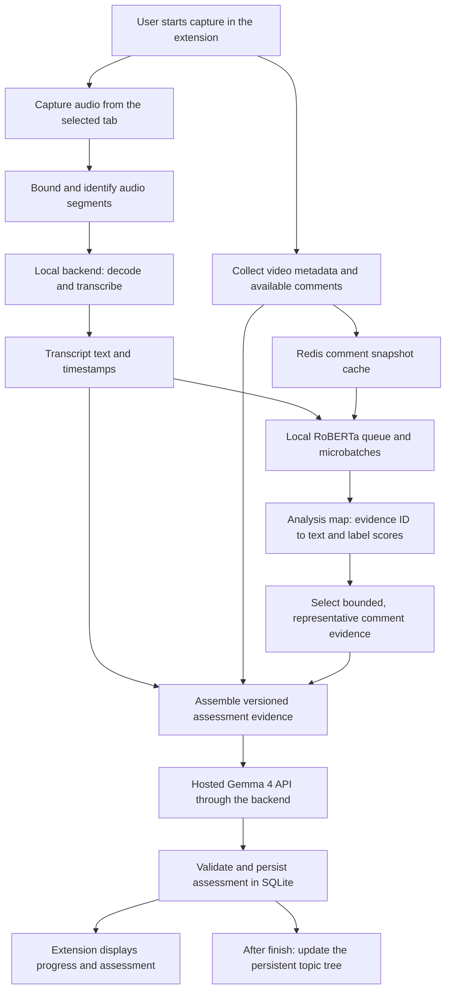

# Video collection and analysis improvements

Research date: October 24, 2026. Scope: architecture review and proposed changes; no capture, Redis, or model-provider implementation is included in this change. Performance conclusions below are hypotheses based on the code and documented APIs, not measured benchmark results.

## Would this improve the extension's performance?

**It could improve assessment quality and reduce the wait for completed reviews, but audio capture itself increases browser and backend work.** Fixed sampling bounds that extra work. Caching avoids repeated work. Overlapping independent stages reduces latency. Hosted Gemma 4 could remove a local inference bottleneck, depending on the provider, network, model variant, and rate limits.

| Proposed change | Likely benefit | Cost or limit |
| --- | --- | --- |
| Sampled audio transcripts | Evidence of what is actually said, especially when metadata is weak | Capture, upload, decoding, and speech recognition add work; speech misses visual-only content |
| Fixed segment budget | Predictable maximum audio duration and inference input | A user may leave before the budget is collected; samples can miss context |
| Parallel pipeline stages | Comment collection and speech recognition overlap | Dependent stages still wait; too much concurrency can increase contention |
| Local RoBERTa | Local text classification without an inference API round trip | CPU/RAM use; the current model classifies sentiment, not harmfulness |
| Redis comment and inference caches | Less fetching and inference for repeated evidence | A cold cache does not help; Redis adds a service and lookup overhead |
| Hosted Gemma 4 | Potentially lower local compute load and assessment latency | Network delay, queueing, usage cost, availability, and external evidence transfer |

The best outcome is a responsive extension with heavier work in the local Python backend. A faster review does not necessarily mean less total computation.

## What the project currently does

These findings come from the implementation rather than only the README:

- [`chrome-react/public/content.js`](chrome-react/public/content.js) detects video changes, records visible-page dwell time, captures page metadata, and attempts Instagram comment collection. Tracking checks run every second. No audio is captured.
- [`chrome-react/public/background.js`](chrome-react/public/background.js) queues events in Chrome storage. Finishing flushes video tabs and sends an immutable session snapshot to the local backend. Collection can work without the backend online.
- [`backend/app/routes/local_sessions.py`](backend/app/routes/local_sessions.py) validates and persists that snapshot and starts background processing.
- [`backend/app/services/local_sessions.py`](backend/app/services/local_sessions.py) combines repeat views, then processes unique videos sequentially. Within each video, YouTube metadata fetching, comment fetching, RoBERTa, and content assessment also run sequentially. It saves progress after each video.
- [`backend/analysis/analyzer.py`](backend/analysis/analyzer.py) already runs RoBERTa locally on CPU through Transformers. It loads the model lazily, batches up to 16 texts, truncates at 512 tokens, and serializes loading/inference with a lock. Adding threads around this method will still encounter the lock.
- Successful individual results and topic batches already have SQLite-backed reuse paths. Redis would add reusable comment/text caches; it would not introduce caching for the first time.
- The local session path computes comment labels, but passes the first 12 raw comment excerpts to `AssessmentComment` without populating each excerpt's optional sentiment/confidence. Gemma receives the aggregate sentiment balance, but this path does not yet select supporting comments using a sentiment map.
- [`backend/analysis/model_output.py`](backend/analysis/model_output.py) currently uses local Ollama first, with hosted **Gemini** fallback. Hosted **Gemma 4** is a different integration. Provider fields currently allow only `ollama` and `gemini` in the assessment schema.
- [`backend/analysis/session_review.py`](backend/analysis/session_review.py) discovers topics after the session finishes. Preserve that distinction from individual video assessment.

## Proposed data flow



RoBERTa consumes **text**, so a speech-to-text stage must sit between audio capture and RoBERTa. Use a local speech recognizer such as faster-whisper as an initial candidate and benchmark a small model on the target laptop. Its maintained implementation supports CPU/GPU execution, quantization, batching, and voice activity detection; those capabilities do not establish a real-time guarantee on this project's hardware. See the [faster-whisper documentation](https://github.com/SYSTRAN/faster-whisper).

Use incremental transcript updates during viewing and one finalized assessment after the sampling budget is reached or the user leaves the video. Describe this as **near-real-time sampled transcription**, rather than a complete real-time transcript of every video.

## Audio capture and sampling

Capture audio only; recording video frames is unnecessary for this proposal. Add `tabCapture` and `offscreen` permissions and an offscreen document that owns the stream and encoder. On Chrome 116+, a stream ID obtained in the service worker can be consumed by an offscreen document. Initiate capture through a supported user invocation of the extension and test that interaction with the current side panel. The background worker should route messages and jobs rather than own the media recorder. See Chrome's [background recording guide](https://developer.chrome.com/docs/extensions/how-to/web-platform/screen-capture).

Tab capture can interrupt normal tab audio playback unless it is connected back to an audio output. Preserve playback, release tracks on stop, and handle capture termination. It captures the tab's audio, which can include ads or other media; it is not automatically isolated to the currently visible Reel. See the [tabCapture API documentation](https://developer.chrome.com/docs/extensions/reference/api/tabCapture).

**Updated policy: derive equal segment boundaries from video duration and a measured latency target.** The segment count is calculated per video rather than fixed at three. This replaces the earlier three-by-five-second proposal. Full coverage and sparse sampling are separate options, described below.

- Keep the calculated number of slots in the result, each with `pending`, `complete`, `partial`, `silent`, or `unavailable` status. Planned coverage and actual collection can differ.
- If the user leaves after two seconds, analyze that partial segment and mark uncaptured slots unavailable. Do not duplicate or pad text to pretend every segment was captured.
- Attach `session_id`, `tab_id`, platform, video ID, encounter ID, segment index, start/end media timestamps, capture generation, and an audio hash. Track both media time and wall time when playback speed or seeking changes.
- Flush/reset segment attribution on a video change. Drop or split boundary-crossing chunks rather than labeling the previous video's audio as the next video's speech. The existing one-second URL polling alone is too coarse to guarantee attribution; synchronize playback/navigation events with the offscreen recorder.
- Record actual coverage, speech availability, language, and transcription status. Music, silence, transcription failures, and unsupported languages should remain explicit.
- Emit decodable segments. `MediaRecorder` timeslice blobs are not guaranteed to be independently decodable files: deliberately finalize each segment or maintain a decoder stream with its initialization data.
- Bound queued bytes and outstanding uploads. Stop collecting beyond the budget and discard raw audio after successful transcription under a documented retention policy. Avoid storing large audio blobs in Chrome's JSON storage.

A fixed segment count alone does not bound RoBERTa work: speech density varies. Also bound token counts and sentence-aware text chunks. If text exceeds the budget, record truncation and coverage rather than silently implying the whole transcript was analyzed.

### Formula for equal segments

For a video with known finite duration `D > 0` seconds and any chosen positive integer `n`:

```text
segment_duration = D / n
start(i) = i × D / n
end(i) = (i + 1) × D / n
for i = 0, ..., n - 1
```

Use half-open intervals `[start, end)` except for the final endpoint. Convert boundaries to integer audio sample indices using `round(i × total_samples / n)` so adjacent segments share exactly the same boundary. Reject `n > total_samples`; otherwise tiny inputs can produce empty segments. The final index must equal `total_samples`.

For `D = 20` seconds and `n = 4`, the intervals are `[0,5)`, `[5,10)`, `[10,15)`, and `[15,20]`. All the audio is covered once. More segments do not reduce the amount of audio to transcribe and can increase per-request overhead.

### Choosing n automatically for fast incremental transcription

There is no universal ideal `n`: it depends on hardware, model, speech density, and the acceptable delay. Derive a target duration from warm-model measurements rather than hard-coding the same count for every clip.

For an initial approximation, measure transcription time over multiple chunk lengths and fit:

```text
transcription_time(d) ≈ h + r × d
```

Here `h` is fixed per-chunk overhead in seconds, `r` is processing seconds per audio second, and `d` is chunk duration. Let `L` be the allowed delay from the start of a live chunk until its transcript is ready. Since the chunk must first play:

```text
d + h + r × d ≤ L
d_latency = (L - h) / (1 + r)
d_target = min(d_latency, d_context)
n = max(1, ceil(D / d_target))
actual_segment_duration = D / n
```

`d_context` is the largest chunk duration supported by the chosen transcription configuration and acceptable accuracy. The formula assumes `L > h`, positive `d_context`, negligible queueing, and capture at normal playback speed. Reserve part of `L` for upload, decoding, queueing, and any downstream work included in the deadline. If the resulting duration is too short to retain useful speech context, use a faster model or relax the deadline rather than creating arbitrarily tiny chunks. This is a starting heuristic, not a guaranteed latency bound: validate with p95 measurements and real audio.

**Illustrative numbers, not benchmark results:** if `L = 6.5 s`, `h = 0.5 s`, `r = 0.2`, and the context limit is at least five seconds, then `d_target = 5 s`:

| Video duration | Calculated n | Equal segment duration |
| --- | --- | --- |
| 12 seconds | 3 | 4 seconds |
| 20 seconds | 4 | 5 seconds |
| 37 seconds | 8 | 4.625 seconds |
| 60 seconds | 12 | 5 seconds |

For completed audio that is already available, capture time is absent: the inference-only approximation instead gives `d_latency = (L - h) / r` for `r > 0`. That is a different latency objective from live transcription.

The live formula chooses the fewest equal chunks that stay under the target duration, limiting repeated overhead. It does not establish optimal throughput or accuracy. Benchmark candidate durations and worker counts; a continuously busy stream also needs processing capacity to keep up with incoming audio.

Read duration from the active media element where accessible. If duration is unknown, changing, or infinite, use rolling windows of `d_target` and finalize the partial last window on exit. Freeze the plan for each encounter and version any change; a live stream cannot be evenly split over an unknown final duration.

### If only part of the video should be sampled

Equal splitting above transcribes the whole video if it is watched. To reduce total work, introduce an audio budget `B > 0` seconds and choose `n` sample regions. For each region:

```text
region_width = D / n
sample_width = min(B / n, region_width)
sample_start(i) = i × region_width + (region_width - sample_width) / 2
sample_end(i) = sample_start(i) + sample_width
```

This places equal-length samples at evenly spaced region centers, with total requested audio `min(B, D)`. Choose `n` so samples are long enough for useful recognition; many tiny samples sacrifice context. Later samples require later playback, so this policy trades early results for broader coverage. Live capture cannot obtain unwatched sections, and seeking/downloading them would be a separate collection design.

At transcription boundaries, speech can be cut mid-word. Consider small context overlaps or speech-aware adjustments after benchmarking, and deduplicate overlapping words before RoBERTa. Keep the equal intervals as the ownership boundaries; any context overlap adds extra processing and must be counted in the budget.

### Fast local audio-to-text options

**Start by benchmarking Whisper `base.en` through faster-whisper, using CPU INT8.** This is a practical initial candidate for this Python backend, not a measured winner on this laptop. faster-whisper is the inference implementation; Whisper `base.en` is the model. Compare `tiny.en` if latency is too high and `small.en` if transcript quality is insufficient. The `.en` variants are for English; use a multilingual variant and record detected language when other speech must be supported. See the [faster-whisper implementation and usage](https://github.com/SYSTRAN/faster-whisper) and the publisher's [small.en model card](https://huggingface.co/Systran/faster-whisper-small.en).

For a machine with a suitable GPU, also benchmark `distil-large-v3`, an English distilled Whisper model supported by faster-whisper. It is not automatically a better CPU choice than a small model. See its [model card and integrations](https://huggingface.co/distil-whisper/distil-large-v3).

Example for one already decoded/decodable segment:

```python
from faster_whisper import WhisperModel

# Initialize once in the backend worker, not once per segment.
model = WhisperModel("base.en", device="cpu", compute_type="int8")

segments, info = model.transcribe(
    "segment.wav",
    language="en",  # Use only when the language is known to be English.
    beam_size=1,    # Benchmark this speed/quality tradeoff against larger beams.
    vad_filter=True,
    condition_on_previous_text=False,
)
transcript = " ".join(segment.text.strip() for segment in segments)
```

The returned segments are lazy: inference must be measured through iteration, including construction of `transcript`. Download/cache model weights once and keep the model warm. Voice activity detection can skip silence but can also miss quiet speech, so evaluate it on real Shorts/Reels audio. This API processes supplied audio; the extension/backend still needs the incremental capture and queueing layer. It does not create a complete streaming system by itself.

## Parallelism that can help

Overlap independent stages, with separate resource limits:

1. Collect metadata/comments while audio is captured and transcribed.
2. Send each completed transcript segment to local RoBERTa while later segments are being captured.
3. Place comments and transcript chunks into a shared inference queue. Use short microbatches with a maximum wait so one video does not wait indefinitely for a full batch.
4. Call Gemma only after the required evidence is ready, or after a deadline with explicit missing-evidence flags.

Start with one loaded RoBERTa instance and one inference worker, preserving its thread-safety boundary. Batch work inside that worker rather than spawning a model per segment. A small bounded transcription pool can operate alongside it, but speech recognition and RoBERTa compete for CPU or GPU resources. Increase concurrency only when measured throughput improves without harming playback.

Move CPU-heavy inference out of the FastAPI event loop; the current code already uses a thread pool around review processing. For sustained workloads, a dedicated model process and durable job records provide clearer resource isolation. Keep retries and job ownership idempotent. Redis caching by itself is not a durable job queue.

A useful latency approximation for the proposed per-video path is:

```text
max(metadata/comment collection,
    sampled audio availability + upload + decode/transcription)
+ remaining RoBERTa queue/inference time
+ hosted Gemma request/validation time
```

This is a dependency model, not a speedup estimate. Capture time is unavoidable: a five-second segment cannot be fully transcribed before its five seconds have played. Starting work during viewing can reduce the remaining wait after Finish without reducing total work.

## Redis caching and the analysis dictionary

Keep Redis behind the backend; the extension should never hold Redis credentials. Keep SQLite as the durable source for session snapshots, accepted assessments, topic identities, and preferences. A Redis outage should cause a cache miss and bounded recomputation, not loss of recorded sessions.

Use separate caches for changing comment snapshots and deterministic text analysis. Suggested initial retention values below are design defaults, not measured optimal settings.

| Cache | Example identity | Proposed retention |
| --- | --- | --- |
| Comment snapshot | user scope + platform + video ID + API query/sort/limit | 10 minutes |
| RoBERTa text result | pinned model revision + preprocessing version + language + normalized-text SHA-256 | 24 hours |
| Transcription | user scope + audio SHA-256 + ASR revision/configuration | 24 hours, if retention permits |
| Final assessment | provider/model revision + prompt/schema/selection versions + evidence fingerprint | Durable SQLite result; optional Redis copy |

Redis hashes can represent the shared map: use `HSET` to store JSON values by evidence identity and a key-level expiry for the bounded hash. Group hashes by video encounter/evidence version so unrelated writes do not keep a global hash alive forever. See [Redis HSET](https://redis.io/docs/latest/commands/hset/) and [EXPIRE](https://redis.io/docs/latest/commands/expire/).

Example application dictionary, using illustrative text and scores:

```python
analysis_by_id = {
    "transcript:encounter-123:segment-0": {
        "source": "transcript",
        "text": "Here is how to build a reusable component.",
        "start_seconds": 0.0,
        "end_seconds": 5.0,
        "label": "neutral",
        "scores": {"negative": 0.04, "neutral": 0.91, "positive": 0.05},
        "model_revision": "<pinned-revision>",
        "text_sha256": "<hash>"
    },
    "comment:comment-456": {
        "source": "comment",
        "text": "This explanation was helpful.",
        "label": "positive",
        "scores": {"negative": 0.01, "neutral": 0.03, "positive": 0.96},
        "model_revision": "<pinned-revision>",
        "text_sha256": "<hash>"
    }
}
```

Keep evidence identity separate from reusable text-cache identity: identical text can reuse inference while retaining different source IDs and timestamps. Include a text hash because comments can be edited. Use short-lived ownership locks or in-flight deduplication to avoid concurrent cache misses running the same inference repeatedly. Do not cache outages as successful empty results.

An in-memory Python dictionary alone is insufficient for sharing across workers or surviving restarts. It can be the assembled per-assessment view, with Redis supplying reusable entries and SQLite storing the accepted evidence/result snapshot.

## Selecting evidence and calling hosted Gemma 4

The current RoBERTa checkpoint is an English tweet sentiment model with positive, neutral, and negative labels. It does not directly detect toxicity, truthfulness, topic relevance, or personal harm. Applying it to transcripts is a domain change that requires evaluation. See the publisher's [model card](https://huggingface.co/cardiffnlp/twitter-roberta-base-sentiment-latest).

Select supporting comments from the map using sentiment **and** diversity/relevance. Start with a capped sample spanning negative, neutral, and positive reactions, remove near duplicates, and retain enough text for context. Do not send only the most negative comments: that would bias Gemma toward a negative assessment. Confidence is not proof that a claim is true.

Gemma should receive:

- Original video metadata and its provenance.
- Bounded transcript excerpts with timestamps, segment labels/scores, language, and capture coverage.
- Supporting comment text with IDs, labels/scores, and an explanation of how the sample was selected.
- Aggregate comment counts/sentiment calculated from the analyzed comment set, not recalculated from the selected excerpts.
- Separate transcript sentiment summaries; do not combine transcript segments and audience comments into one undifferentiated balance.
- Explicit missing-evidence and transcription-quality flags.

Send text as well as labels: a label such as `negative` discards the meaning Gemma needs. Ask Gemma to distinguish video speech from audience claims and cite evidence IDs in its reasoning. Keep strict schema validation, bounded retries, and provider provenance.

Google documents Gemma 4 in its [Gemma overview](https://ai.google.dev/gemma/docs). This review has **not verified a particular third-party deployment, exact model ID, pricing, or latency**. The existing `gemma4:e2b` Ollama tag is not automatically a valid hosted-provider model identifier. Gemma and Gemini are distinct model families.

Add a backend provider adapter with configurable API base URL, API key, exact Gemma 4 model ID, timeout, concurrency cap, and output budget. Keep keys in backend environment configuration. Update provider enums, error handling, response parsing, and cache fingerprints. Preserve topic discovery as a separate completed-session step; decide explicitly whether that step also moves to hosted Gemma. A provider may not support the same structured-output parameters as Ollama.

Cache assessments by all meaningful inputs, including transcript hashes, comment evidence, prompt/schema versions, and model revision. Otherwise the current evidence fingerprint could incorrectly reuse an assessment after new speech evidence arrives. Use an evidence version so late results cannot overwrite a newer assessment.

Hosted assessment sends selected text outside the local machine even though ASR and RoBERTa remain local. Make that transfer visible in the product and send only the bounded evidence needed for the assessment. On provider failure, retain local results and show an incomplete assessment that can be retried.

## Suggested implementation sequence

1. **Measure the existing pipeline:** add stage timings, queue depth, input sizes, and cache-reuse counters. Record cold model startup separately from warm execution.
2. **Improve the existing text path:** add Redis comment/text caches, pass labeled supporting comments to Gemma, and overlap metadata/comment requests. Preserve SQLite recovery.
3. **Integrate hosted Gemma 4:** confirm provider/model details and benchmark it against current Ollama using identical evidence and validation rules.
4. **Add opt-in audio sampling:** offscreen capture, duration-derived segment boundaries and a configurable audio budget, attribution safeguards, and local transcription. Begin with one captured tab to simplify ownership.
5. **Add incremental ingestion:** new audio/evidence endpoints during viewing, with durable references linked to the final session snapshot. The existing finish-only JSON snapshot cannot carry real-time binary audio or accept changed payloads under the same completed session ID.
6. **Tune microbatching and bounded concurrency:** keep accepted per-video assessments versioned and preserve completed-session topic discovery and tree validation.

Likely edit locations are the extension manifest/background/content scripts, new offscreen capture files, new backend audio/ASR/cache modules, `local_sessions.py`, `analyzer.py`, `video_assessment.py`, provider adapters, configuration/dependencies, and result types in the review UI. Topic evidence packing and eligibility currently depend on titles/captions; extend them deliberately if transcript-only videos should support topics, without removing input budgets.

## How to establish whether it works better

Compare the existing pipeline, text-cache/concurrency changes, hosted Gemma without audio, and the full audio pipeline. Use identical recorded fixtures where possible; include fast scrolling, repeat views, silence/music, poor metadata, multiple languages, tab changes, seeking, and provider failures.

| Dimension | Measurements |
| --- | --- |
| User-visible latency | Median/p95 time to first transcript, per-video assessment, and final session review |
| Backend efficiency | Stage durations, queue wait, processed audio seconds per wall-clock second, warm/cold cache hit rates |
| Browser overhead | CPU, memory, upload bytes, playback glitches, and capture stops |
| Quality | Human-reviewed transcript accuracy, video/segment attribution, sentiment agreement, and supported assessment judgments |
| Reliability | Duplicate-job handling, expired caches, Redis outage behavior, restart recovery, late-result rejection, and API rate-limit recovery |
| Cost | Hosted requests and tokens per video/session; local compute and retained evidence size |

Test meaningful behavior: a quick swipe must not mix two videos' audio; cache hits must skip matching inference; model/preprocessing changes must invalidate reuse; silent segments must not invent transcripts; a Redis outage must preserve sessions; failed hosted requests must retain local evidence; sampled negative comments must not replace the aggregate distribution.

**Recommendation:** adopt fixed audio sampling as an evidence-quality improvement, and use caching, staged overlap, and hosted inference as separately measurable latency optimizations. Keep local RoBERTa batched and resource-bounded. Do not promise a speedup or better assessment accuracy until the target hardware and chosen Gemma 4 service have been evaluated.
